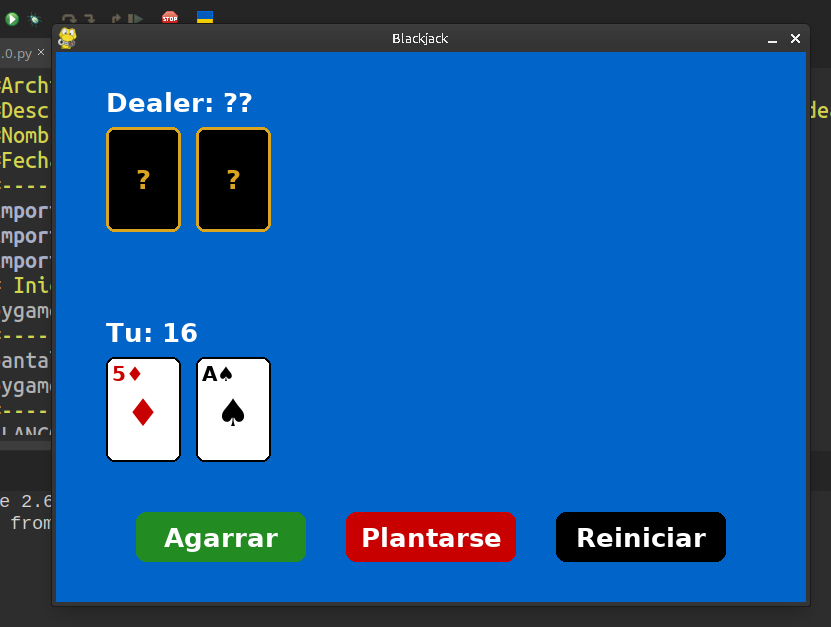
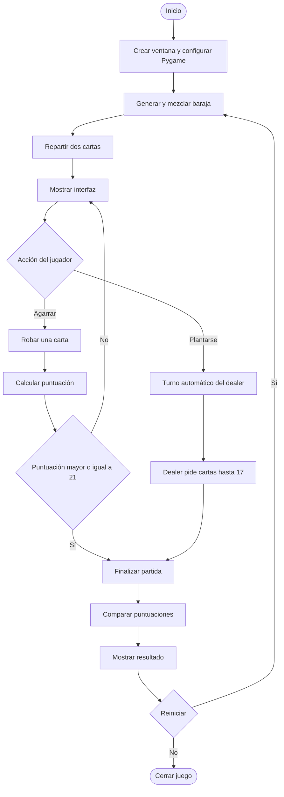
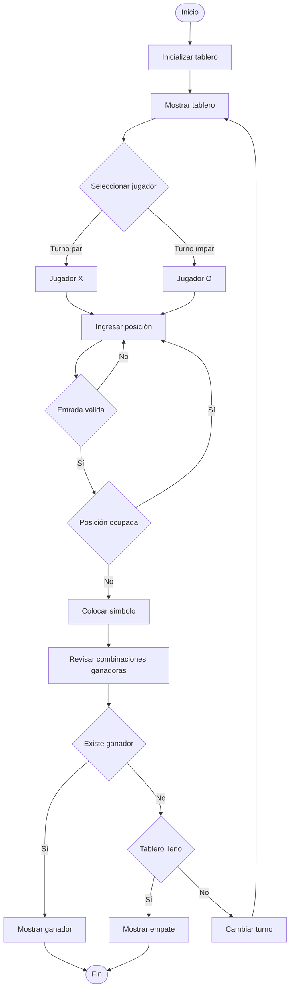
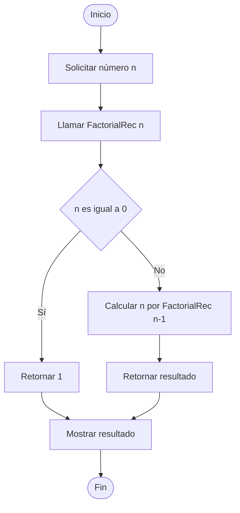

# Programación 1

## Descripción del proyecto

Este repositorio contiene una recopilación de programas y ejercicios desarrollados durante la materia de **Programación 1**.

Su propósito es aplicar y reforzar los fundamentos de la programación mediante la resolución de problemas matemáticos, el desarrollo de juegos y la implementación de algoritmos utilizando Python.

Cada programa se encuentra organizado en su propia carpeta, con el objetivo de mantener una estructura ordenada que facilite su consulta, ejecución y modificación.

---

## Contenido del repositorio

El repositorio está compuesto por los siguientes programas:

| Programa | Descripción | Tecnologías |
|---|---|---|
| Blackjack_1.0 | Juego de Blackjack con interfaz gráfica. | Python, Pygame |
| Gato | Juego de tres en raya para dos jugadores. | Python |
| Factorial | Calculadora de factorial mediante recursividad. | Python |

---

# 1. Blackjack_1.0

## Descripción

Juego de Blackjack desarrollado en Python utilizando la biblioteca Pygame para implementar una interfaz gráfica interactiva.

El jugador compite contra un dealer controlado por la computadora. El objetivo es conseguir una puntuación lo más cercana posible a 21, sin superarla, y obtener una puntuación superior a la del dealer.

## Características principales

- Interfaz gráfica de 750 × 550 píxeles.
- Generación de una baraja de 52 cartas.
- Cuatro palos: corazones, diamantes, tréboles y picas.
- Mezcla aleatoria de cartas.
- Repartición inicial de dos cartas para cada participante.
- Botón para solicitar cartas adicionales.
- Botón para plantarse y finalizar el turno del jugador.
- Turno automático del dealer.
- Cálculo de puntuaciones.
- Reconocimiento del valor especial de los ases.
- Identificación de victorias, derrotas y empates.
- Botón para reiniciar la partida.

## Funcionamiento

El programa genera una baraja de 52 cartas y la mezcla aleatoriamente. Posteriormente, reparte dos cartas al jugador y dos al dealer.

Durante el turno del jugador existen dos acciones principales:

1. **Agarrar:** solicita una carta adicional y actualiza la puntuación.
2. **Plantarse:** termina el turno del jugador y permite que el dealer juegue.

El dealer solicita cartas automáticamente mientras su puntuación sea inferior a 17.

Al finalizar la partida, se muestran las cartas del dealer, las puntuaciones y el resultado.

## Ejemplo de funcionamiento



## Reglas de puntuación

| Carta | Valor |
|---|---:|
| As | 11 o 1 |
| Cartas del 2 al 10 | Su valor numérico |
| J, Q, K | 10 |

Cuando la puntuación supera 21 y existen ases contabilizados como 11, el programa reduce su valor a 1.

## Requisitos

- Python 3.
- Biblioteca Pygame.
- Sistema operativo compatible con Pygame.

Instalación de la dependencia:

```bash
python3 -m pip install pygame
```

## Instrucciones de ejecución

Entrar a la carpeta `Blackjack_1.0` y ejecutar:

```bash
python3 Blackjack_1.0.py
```

El nombre del archivo debe coincidir con el archivo real del proyecto.

## Diagrama de funcionamiento



---

# 2. Gato

## Descripción

Juego clásico de Gato, también conocido como tres en raya, desarrollado en Python para dos jugadores.

Los participantes utilizan los símbolos X y O para realizar sus movimientos en un tablero de nueve posiciones.

El objetivo es conseguir tres símbolos iguales en una misma fila, columna o diagonal.

## Características principales

- Tablero de 3 × 3.
- Dos jugadores: X y O.
- Selección de posiciones mediante números del 1 al 9.
- Validación del rango de las posiciones.
- Detección de posiciones ocupadas.
- Control de turnos alternados.
- Identificación automática del ganador.
- Detección de empates.
- Representación del tablero mediante caracteres de texto.

## Distribución del tablero

Las posiciones se encuentran organizadas de la siguiente manera:

```text
╔═══╦═══╦═══╗
║ 1 ║ 2 ║ 3 ║
╠═══╬═══╬═══╣
║ 4 ║ 5 ║ 6 ║
╠═══╬═══╬═══╣
║ 7 ║ 8 ║ 9 ║
╚═══╩═══╩═══╝
```

## Funcionamiento

El juego comienza mostrando el tablero vacío con sus nueve posiciones disponibles.

El jugador X realiza el primer movimiento y posteriormente juega el participante O. Los turnos continúan alternándose hasta que se cumpla alguna de las siguientes condiciones:

- Un jugador consigue tres símbolos iguales en línea.
- Se ocupan las nueve posiciones sin que exista un ganador.

El programa comprueba las ocho combinaciones posibles de victoria: tres filas, tres columnas y dos diagonales.

También verifica que las posiciones seleccionadas estén disponibles y que los valores introducidos sean válidos.

## Requisitos

- Python 3.10 o superior, debido al uso de la estructura `match-case`.
- Terminal o consola compatible con caracteres Unicode.

No requiere bibliotecas externas.

## Instrucciones de ejecución

Entrar a la carpeta `Gato` y ejecutar:

```bash
python3 Gato.py
```

## Ejemplo de entrada

```text
Tu turno X:
Donde pondras 1-9: 5

Tu turno O:
Donde pondras 1-9: 1

Tu turno X:
Donde pondras 1-9: 2
```

## Ejemplo de salida

```text
JUEGO DEL GATO
╔═══╦═══╦═══╗
║ O ║ X ║ 3 ║
╠═══╬═══╬═══╣
║ 4 ║ X ║ 6 ║
╠═══╬═══╬═══╣
║ 7 ║ X ║ 9 ║
╚═══╩═══╩═══╝

Gano el jugador: X
```

## Diagrama de funcionamiento



---

# 3. Factorial

## Descripción

Programa desarrollado en Python para calcular el factorial de un número entero mediante el uso de recursividad.

El programa solicita al usuario un número y utiliza una función recursiva para calcular el resultado.

## ¿Qué es el factorial?

El factorial de un número entero no negativo es el producto de todos los números enteros positivos menores o iguales a dicho número.

Se representa mediante el símbolo `!`.

Por ejemplo:

```text
5! = 5 × 4 × 3 × 2 × 1 = 120
```

Por definición:

```text
0! = 1
```

## Características principales

- Entrada de datos mediante teclado.
- Función recursiva `FactorialRec(n)`.
- Uso de parámetros y valores de retorno.
- Caso base para detener la recursividad.
- Multiplicación de resultados mediante llamadas recursivas.

## Funcionamiento

El programa solicita un número entero y lo envía como argumento a la función `FactorialRec()`.

La función comprueba si el número es igual a cero. Si se cumple esta condición, devuelve 1 y finaliza la recursividad.

En caso contrario, multiplica el número actual por el resultado de llamar nuevamente a la función con el número anterior.

Este procedimiento continúa hasta alcanzar el caso base.

## Requisitos

- Python 3.
- Terminal o consola de comandos.

No requiere bibliotecas externas.

## Instrucciones de ejecución

Entrar a la carpeta `Factorial` y ejecutar:

```bash
python3 Factorial(Funcion en si misma).py
```

## Ejemplo de entrada

```text
Numero para sacar factorial: 5
```

## Ejemplo de salida

```text
120
```

## Diagrama de funcionamiento



---

# Requisitos generales del repositorio

Para ejecutar los programas se recomienda contar con:

| Requisito | Descripción |
|---|---|
| Lenguaje | Python 3 |
| Sistema operativo | Windows, Linux o macOS |
| Editor | Thonny, Visual Studio Code o similar |
| Terminal | Consola de comandos |
| Dependencias | Pygame únicamente para Blackjack_1.0 |

**Versiones mínimas recomendadas:**

- Python 3.10 para todos los programas, considerando la compatibilidad con `match-case` del juego Gato.
- Pygame instalado para ejecutar Blackjack_1.0.

---

# Instalación y ejecución del repositorio

## 1. Clonar el repositorio

```bash
git clone https://github.com/Angelo-fen/Programacion-1.git
```

## 2. Acceder al directorio

```bash
cd Programacion-1
```

## 3. Instalar las dependencias

Para instalar Pygame:

```bash
python3 -m pip install pygame
```

## 4. Ejecutar un programa

Acceder a la carpeta correspondiente y ejecutar el archivo Python.

Ejemplo:

```bash
cd Blackjack_1.0
python3 Blackjack_1.0.py
```

---

# Objetivos académicos

Los programas incluidos en este repositorio permiten practicar diferentes fundamentos de programación:

| Concepto | Aplicación |
|---|---|
| Variables y tipos de datos | Los tres programas |
| Condicionales | Gato y Blackjack |
| Ciclos repetitivos | Gato y Blackjack |
| Funciones | Los tres programas |
| Listas | Gato y Blackjack |
| Recursividad | Factorial |
| Manejo de entradas | Los tres programas |
| Validación de datos | Gato |
| Bibliotecas externas | Blackjack |
| Interfaces gráficas | Blackjack |
| Generación de números aleatorios | Blackjack |

---

# Autoría

**Autor:** Angel Gustavo Camargo Bermudez

**Colaborador:** Luis Suares Garcia (Blackjack_1.0)

**Materia:** Programación 1

**Repositorio:** [Programación 1 - GitHub](https://github.com/Angelo-fen/Programacion-1)

**Perfil de GitHub:** [Angelo-fen](https://github.com/Angelo-fen)

---

# Propósito del repositorio

Este repositorio tiene fines académicos y documenta el aprendizaje y desarrollo de habilidades de programación mediante ejercicios prácticos.

Los programas representan diferentes aplicaciones de los fundamentos de Python, desde operaciones matemáticas mediante recursividad hasta juegos interactivos con lógica de programación e interfaces gráficas.